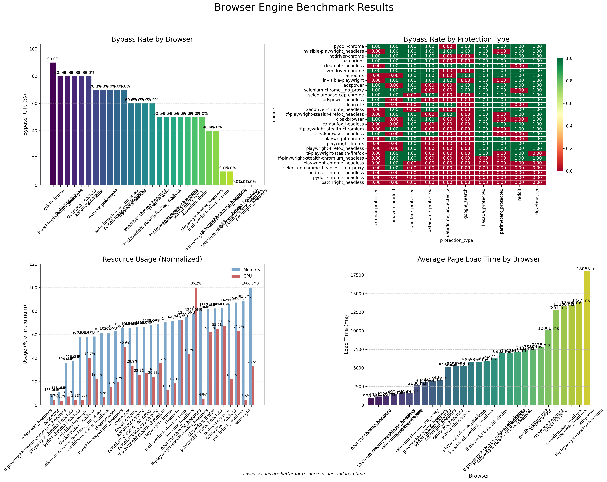
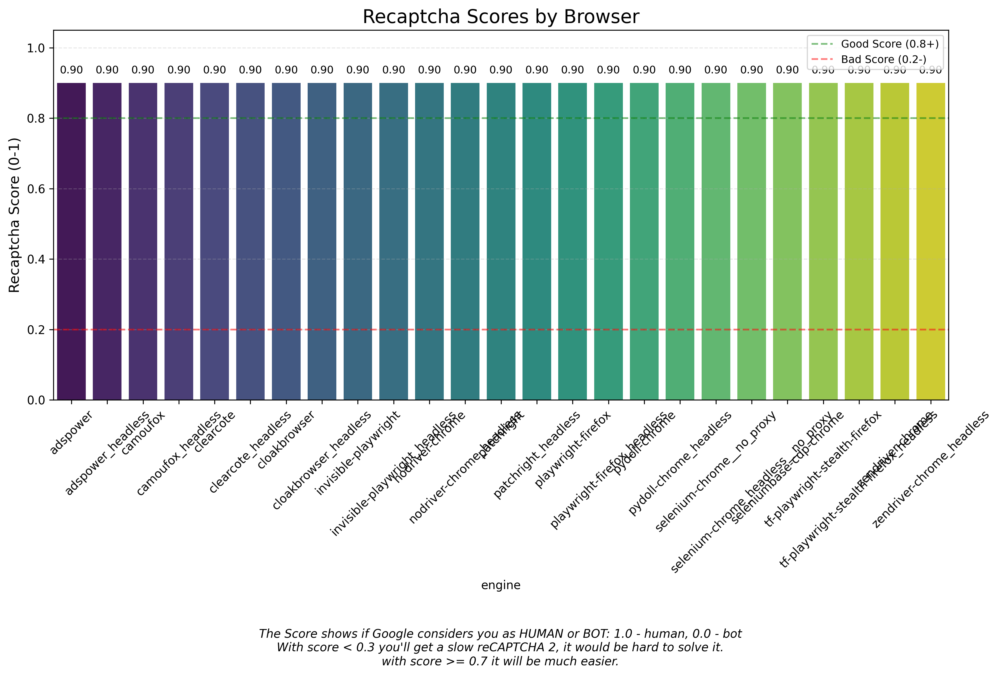
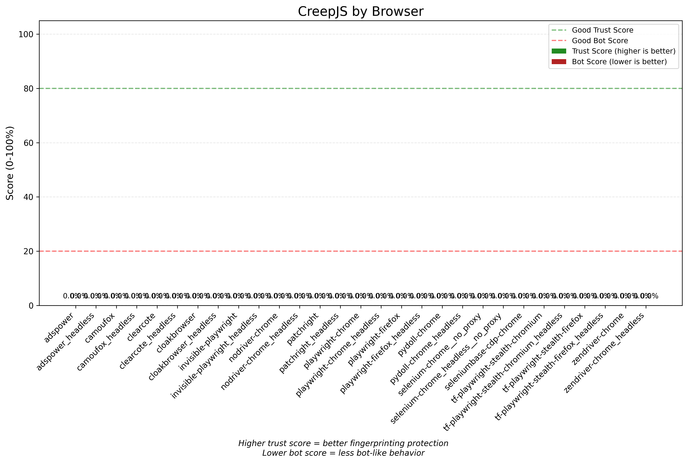

# Browser Benchmark Results Summary

*Generated on: 2026-11-20 20:46*

## Overall Bypass Rate

| Engine | Bypass Rate (%) |
|-----------------|----------------:|
| pydoll-chrome | 90.0 |
| invisible-playwright_headless | 80.0 |
| nodriver-chrome | 80.0 |
| patchright | 80.0 |
| clearcote_headless | 80.0 |
| zendriver-chrome | 80.0 |
| camoufox | 70.0 |
| invisible-playwright | 70.0 |
| adspower | 70.0 |
| selenium-chrome__no_proxy | 70.0 |
| seleniumbase-cdp-chrome | 70.0 |
| adspower_headless | 60.0 |
| clearcote | 60.0 |
| zendriver-chrome_headless | 60.0 |
| tf-playwright-stealth-firefox_headless | 60.0 |
| cloakbrowser | 50.0 |
| camoufox_headless | 50.0 |
| tf-playwright-stealth-chromium | 50.0 |
| cloakbrowser_headless | 50.0 |
| playwright-chrome | 50.0 |
| playwright-firefox | 50.0 |
| playwright-firefox_headless | 50.0 |
| tf-playwright-stealth-firefox | 40.0 |
| tf-playwright-stealth-chromium_headless | 40.0 |
| playwright-chrome_headless | 10.0 |
| selenium-chrome_headless__no_proxy | 10.0 |
| nodriver-chrome_headless | 0.0 |
| pydoll-chrome_headless | 0.0 |
| patchright_headless | 0.0 |

## Resource Usage Comparison

| Engine | Memory Usage (MB) | CPU Usage (%) |
|-----------------|------------------:|--------------:|
| adspower_headless | 158.0 | 3.7 |
| adspower | 185.0 | 3.3 |
| tf-playwright-stealth-chromium_headless | 596.0 | 6.3 |
| playwright-chrome_headless | 626.0 | 3.9 |
| pydoll-chrome_headless | 970.0 | 4.0 |
| invisible-playwright | 971.0 | 34.7 |
| cloakbrowser_headless | 973.0 | 19.4 |
| selenium-chrome_headless__no_proxy | 1017.0 | 5.8 |
| zendriver-chrome_headless | 1026.0 | 13.1 |
| cloakbrowser | 1056.0 | 16.7 |
| invisible-playwright_headless | 1090.0 | 42.6 |
| camoufox | 1092.0 | 28.9 |
| pydoll-chrome | 1103.0 | 22.3 |
| zendriver-chrome | 1108.0 | 23.3 |
| selenium-chrome__no_proxy | 1138.0 | 20.8 |
| seleniumbase-cdp-chrome | 1146.0 | 30.7 |
| tf-playwright-stealth-chromium | 1173.0 | 10.8 |
| playwright-chrome | 1187.0 | 15.9 |
| clearcote | 1203.0 | 62.4 |
| tf-playwright-stealth-firefox | 1253.0 | 37.2 |
| clearcote_headless | 1293.0 | 86.2 |
| nodriver-chrome_headless | 1330.0 | 4.5 |
| tf-playwright-stealth-firefox_headless | 1362.0 | 53.3 |
| playwright-firefox | 1370.0 | 55.9 |
| playwright-firefox_headless | 1373.0 | 58.3 |
| nodriver-chrome | 1429.0 | 18.9 |
| camoufox_headless | 1454.0 | 54.5 |
| patchright_headless | 1481.0 | 3.6 |
| patchright | 1666.0 | 28.5 |

## Recaptcha Scores

| Engine | Recaptcha Score (0-1) |
|-----------------|--------------------:|
| adspower | 0.90 |
| adspower_headless | 0.90 |
| camoufox | 0.90 |
| camoufox_headless | 0.90 |
| clearcote | 0.90 |
| clearcote_headless | 0.90 |
| cloakbrowser | 0.90 |
| cloakbrowser_headless | 0.90 |
| invisible-playwright | 0.90 |
| invisible-playwright_headless | 0.90 |
| nodriver-chrome | 0.90 |
| nodriver-chrome_headless | 0.90 |
| patchright | 0.90 |
| patchright_headless | 0.90 |
| playwright-firefox | 0.90 |
| playwright-firefox_headless | 0.90 |
| pydoll-chrome | 0.90 |
| pydoll-chrome_headless | 0.90 |
| selenium-chrome__no_proxy | 0.90 |
| selenium-chrome_headless__no_proxy | 0.90 |
| seleniumbase-cdp-chrome | 0.90 |
| tf-playwright-stealth-firefox | 0.90 |
| tf-playwright-stealth-firefox_headless | 0.90 |
| zendriver-chrome | 0.90 |
| zendriver-chrome_headless | 0.90 |
| playwright-chrome | nan |
| playwright-chrome_headless | nan |
| tf-playwright-stealth-chromium | nan |
| tf-playwright-stealth-chromium_headless | nan |

## CreepJS Scores

| Engine | Trust Score (%) | Bot Score (%) | WebRTC IP |
|-----------------|----------------:|--------------:|----------:|
| adspower | 0.00 | 0.00 | 76.38.23.42 |
| adspower_headless | 0.00 | 0.00 | 96.27.46.243 |
| camoufox | 0.00 | 0.00 | 50.26.201.59 |
| camoufox_headless | 0.00 | 0.00 | 107.136.236.92 |
| clearcote | 0.00 | 0.00 | 162.220.232.51 |
| clearcote_headless | 0.00 | 0.00 | 184.58.65.71 |
| cloakbrowser | 0.00 | 0.00 | 99.129.117.52 |
| cloakbrowser_headless | 0.00 | 0.00 | 76.97.38.119 |
| invisible-playwright | 0.00 | 0.00 |  |
| invisible-playwright_headless | 0.00 | 0.00 |  |
| nodriver-chrome | 0.00 | 0.00 | REAL_IP |
| nodriver-chrome_headless | 0.00 | 0.00 | REAL_IP |
| patchright | 0.00 | 0.00 | REAL_IP |
| patchright_headless | 0.00 | 0.00 | REAL_IP |
| playwright-chrome | 0.00 | 0.00 | REAL_IP |
| playwright-chrome_headless | 0.00 | 0.00 | REAL_IP |
| playwright-firefox | 0.00 | 0.00 | REAL_IP |
| playwright-firefox_headless | 0.00 | 0.00 | REAL_IP |
| pydoll-chrome | 0.00 | 0.00 | REAL_IP |
| pydoll-chrome_headless | 0.00 | 0.00 | REAL_IP |
| selenium-chrome__no_proxy | 0.00 | 0.00 | REAL_IP |
| selenium-chrome_headless__no_proxy | 0.00 | 0.00 | REAL_IP |
| seleniumbase-cdp-chrome | 0.00 | 0.00 |  |
| tf-playwright-stealth-chromium | 0.00 | 0.00 | REAL_IP |
| tf-playwright-stealth-chromium_headless | 0.00 | 0.00 | REAL_IP |
| tf-playwright-stealth-firefox | 0.00 | 0.00 | REAL_IP |
| tf-playwright-stealth-firefox_headless | 0.00 | 0.00 | REAL_IP |
| zendriver-chrome | 0.00 | 0.00 |  |
| zendriver-chrome_headless | 0.00 | 0.00 |  |

## IP (Ipify) 

| Engine | IP |
|-----------------|----------:|
| adspower | 67.173.191.76 |
| adspower_headless | 96.27.46.243 |
| camoufox | 50.26.201.59 |
| camoufox_headless | 107.136.236.92 |
| clearcote | 162.220.232.51 |
| clearcote_headless | 173.64.64.227 |
| cloakbrowser | 99.129.117.52 |
| cloakbrowser_headless | 108.206.169.72 |
| invisible-playwright | 74.194.143.108 |
| invisible-playwright_headless | 24.49.49.192 |
| nodriver-chrome | 104.176.174.41 |
| nodriver-chrome_headless | 71.75.40.222 |
| patchright | 68.192.100.74 |
| patchright_headless | 72.200.220.88 |
| playwright-chrome | 73.96.79.106 |
| playwright-chrome_headless | 108.207.76.135 |
| playwright-firefox | 68.54.208.109 |
| playwright-firefox_headless | 72.82.21.32 |
| pydoll-chrome | 68.226.171.120 |
| pydoll-chrome_headless | 23.117.134.46 |
| selenium-chrome__no_proxy | REAL_IP |
| selenium-chrome_headless__no_proxy | REAL_IP |
| seleniumbase-cdp-chrome | 204.111.137.63 |
| tf-playwright-stealth-chromium | 76.117.112.121 |
| tf-playwright-stealth-chromium_headless | 24.192.108.243 |
| tf-playwright-stealth-firefox | 82.40.102.67 |
| tf-playwright-stealth-firefox_headless | 135.26.83.225 |
| zendriver-chrome | 73.16.149.151 |
| zendriver-chrome_headless | 99.68.64.97 |

## Visual Dashboard

## Recaptcha Score Visualization

## CreepJS Visualization

