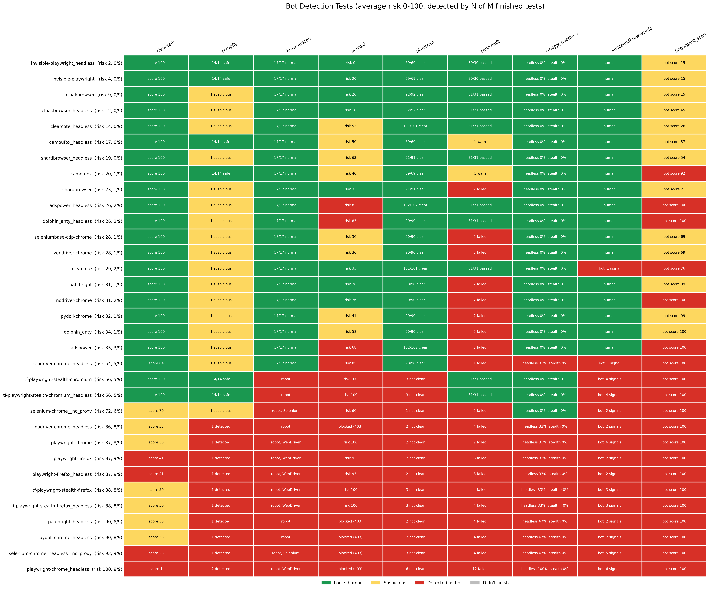

# Browser Benchmark Results Summary

*Generated on: 2026-11-25 17:25*

## Overall Ranking

Overall score is the average of the bypass rate and 100 minus the detection risk (see Bot Detection Tests), both weighted equally.

| Engine | Overall score | Bypass Rate (%) | Detected by | Detection risk |
|-----------------|--------------:|----------------:|------------:|---------------:|
| invisible-playwright_headless | 89.2 | 80.0 | 0/9 | 2 |
| invisible-playwright | 88.1 | 80.0 | 0/9 | 4 |
| camoufox | 84.9 | 90.0 | 1/9 | 20 |
| camoufox_headless | 81.3 | 80.0 | 0/9 | 17 |
| clearcote_headless | 77.8 | 70.0 | 0/9 | 14 |
| patchright | 74.7 | 80.0 | 1/9 | 31 |
| pydoll-chrome | 73.9 | 80.0 | 1/9 | 32 |
| shardbrowser | 73.7 | 70.0 | 1/9 | 23 |
| zendriver-chrome | 70.8 | 70.0 | 1/9 | 28 |
| clearcote | 70.6 | 70.0 | 2/9 | 29 |
| cloakbrowser | 70.3 | 50.0 | 0/9 | 9 |
| nodriver-chrome | 69.7 | 70.0 | 2/9 | 31 |
| cloakbrowser_headless | 69.2 | 50.0 | 0/9 | 12 |
| seleniumbase-cdp-chrome | 65.8 | 60.0 | 1/9 | 28 |
| shardbrowser_headless | 65.7 | 50.0 | 0/9 | 19 |
| dolphin_anty | 62.9 | 60.0 | 1/9 | 34 |
| dolphin_anty_headless | 62.1 | 50.0 | 2/9 | 26 |
| zendriver-chrome_headless | 58.1 | 70.0 | 5/9 | 54 |
| adspower | 52.3 | 40.0 | 3/9 | 35 |
| adspower_headless | 47.1 | 20.0 | 2/9 | 26 |
| selenium-chrome__no_proxy | 44.1 | 60.0 | 6/9 | 72 |
| tf-playwright-stealth-chromium | 42.2 | 40.0 | 5/9 | 56 |
| tf-playwright-stealth-chromium_headless | 42.2 | 40.0 | 5/9 | 56 |
| playwright-firefox | 36.4 | 60.0 | 9/9 | 87 |
| playwright-firefox_headless | 36.4 | 60.0 | 9/9 | 87 |
| playwright-chrome | 31.5 | 50.0 | 8/9 | 87 |
| tf-playwright-stealth-firefox | 31.1 | 50.0 | 8/9 | 88 |
| tf-playwright-stealth-firefox_headless | 26.1 | 40.0 | 8/9 | 88 |
| pydoll-chrome_headless | 10.1 | 10.0 | 8/9 | 90 |
| selenium-chrome_headless__no_proxy | 8.4 | 10.0 | 9/9 | 93 |
| nodriver-chrome_headless | 6.9 | 0.0 | 8/9 | 86 |
| patchright_headless | 5.1 | 0.0 | 8/9 | 90 |
| playwright-chrome_headless | 0.1 | 0.0 | 9/9 | 100 |

## Bot Detection Tests

✅ looks human · ⚠️ suspicious · ❌ detected as bot · ❔ test didn't finish (not counted)

Risk (0 - human, 100 - bot) is the average over the tests: the site's own score where it has one (CleanTalk: 100 - Human Score, APIVoid: risk score, CreepJS: headless/stealth %, Fingerprint-Scan: bot score), otherwise its verdict (✅ 0, ⚠️ 50, ❌ 100). Engines are sorted by it.

| Engine | cleantalk | scrapfly | browserscan | apivoid | pixelscan | sannysoft | creepjs_headless | deviceandbrowserinfo | fingerprint_scan | Detected by | Risk |
|-----------------|:---:|:---:|:---:|:---:|:---:|:---:|:---:|:---:|:---:|------------:|-----:|
| invisible-playwright_headless | ✅ score 100 | ✅ 14/14 safe | ✅ 17/17 normal | ✅ risk 0 | ✅ 69/69 clear | ✅ 30/30 passed | ✅ headless 0%, stealth 0% | ✅ human | ⚠️ bot score 15 | 0/9 | 2 |
| invisible-playwright | ✅ score 100 | ✅ 14/14 safe | ✅ 17/17 normal | ✅ risk 20 | ✅ 69/69 clear | ✅ 30/30 passed | ✅ headless 0%, stealth 0% | ✅ human | ⚠️ bot score 15 | 0/9 | 4 |
| cloakbrowser | ✅ score 100 | ⚠️ 1 suspicious | ✅ 17/17 normal | ✅ risk 20 | ✅ 92/92 clear | ✅ 31/31 passed | ✅ headless 0%, stealth 0% | ✅ human | ⚠️ bot score 15 | 0/9 | 9 |
| cloakbrowser_headless | ✅ score 100 | ⚠️ 1 suspicious | ✅ 17/17 normal | ✅ risk 10 | ✅ 92/92 clear | ✅ 31/31 passed | ✅ headless 0%, stealth 0% | ✅ human | ⚠️ bot score 45 | 0/9 | 12 |
| clearcote_headless | ✅ score 100 | ⚠️ 1 suspicious | ✅ 17/17 normal | ⚠️ risk 53 | ✅ 101/101 clear | ✅ 31/31 passed | ✅ headless 0%, stealth 0% | ✅ human | ⚠️ bot score 26 | 0/9 | 14 |
| camoufox_headless | ✅ score 100 | ✅ 14/14 safe | ✅ 17/17 normal | ⚠️ risk 50 | ✅ 69/69 clear | ⚠️ 1 warn | ✅ headless 0%, stealth 0% | ✅ human | ⚠️ bot score 57 | 0/9 | 17 |
| shardbrowser_headless | ✅ score 100 | ⚠️ 1 suspicious | ✅ 17/17 normal | ⚠️ risk 63 | ✅ 91/91 clear | ✅ 31/31 passed | ✅ headless 0%, stealth 0% | ✅ human | ⚠️ bot score 54 | 0/9 | 19 |
| camoufox | ✅ score 100 | ✅ 14/14 safe | ✅ 17/17 normal | ⚠️ risk 40 | ✅ 69/69 clear | ⚠️ 1 warn | ✅ headless 0%, stealth 0% | ✅ human | ❌ bot score 92 | 1/9 | 20 |
| shardbrowser | ✅ score 100 | ⚠️ 1 suspicious | ✅ 17/17 normal | ✅ risk 33 | ✅ 91/91 clear | ❌ 2 failed | ✅ headless 0%, stealth 0% | ✅ human | ⚠️ bot score 21 | 1/9 | 23 |
| adspower_headless | ✅ score 100 | ⚠️ 1 suspicious | ✅ 17/17 normal | ❌ risk 83 | ✅ 102/102 clear | ✅ 31/31 passed | ✅ headless 0%, stealth 0% | ✅ human | ❌ bot score 100 | 2/9 | 26 |
| dolphin_anty_headless | ✅ score 100 | ⚠️ 1 suspicious | ✅ 17/17 normal | ❌ risk 83 | ✅ 90/90 clear | ✅ 31/31 passed | ✅ headless 0%, stealth 0% | ✅ human | ❌ bot score 100 | 2/9 | 26 |
| seleniumbase-cdp-chrome | ✅ score 100 | ⚠️ 1 suspicious | ✅ 17/17 normal | ⚠️ risk 36 | ✅ 90/90 clear | ❌ 2 failed | ✅ headless 0%, stealth 0% | ✅ human | ⚠️ bot score 69 | 1/9 | 28 |
| zendriver-chrome | ✅ score 100 | ⚠️ 1 suspicious | ✅ 17/17 normal | ⚠️ risk 36 | ✅ 90/90 clear | ❌ 2 failed | ✅ headless 0%, stealth 0% | ✅ human | ⚠️ bot score 69 | 1/9 | 28 |
| clearcote | ✅ score 100 | ⚠️ 1 suspicious | ✅ 17/17 normal | ✅ risk 33 | ✅ 101/101 clear | ✅ 31/31 passed | ✅ headless 0%, stealth 0% | ❌ bot, 1 signal | ❌ bot score 76 | 2/9 | 29 |
| patchright | ✅ score 100 | ⚠️ 1 suspicious | ✅ 17/17 normal | ✅ risk 26 | ✅ 90/90 clear | ❌ 2 failed | ✅ headless 0%, stealth 0% | ✅ human | ⚠️ bot score 99 | 1/9 | 31 |
| nodriver-chrome | ✅ score 100 | ⚠️ 1 suspicious | ✅ 17/17 normal | ✅ risk 26 | ✅ 90/90 clear | ❌ 2 failed | ✅ headless 0%, stealth 0% | ✅ human | ❌ bot score 100 | 2/9 | 31 |
| pydoll-chrome | ✅ score 100 | ⚠️ 1 suspicious | ✅ 17/17 normal | ⚠️ risk 41 | ✅ 90/90 clear | ❌ 2 failed | ✅ headless 0%, stealth 0% | ✅ human | ⚠️ bot score 99 | 1/9 | 32 |
| dolphin_anty | ✅ score 100 | ⚠️ 1 suspicious | ✅ 17/17 normal | ⚠️ risk 58 | ✅ 90/90 clear | ❌ 2 failed | ✅ headless 0%, stealth 0% | ✅ human | ⚠️ bot score 100 | 1/9 | 34 |
| adspower | ✅ score 100 | ⚠️ 1 suspicious | ✅ 17/17 normal | ❌ risk 68 | ✅ 102/102 clear | ❌ 2 failed | ✅ headless 0%, stealth 0% | ✅ human | ❌ bot score 100 | 3/9 | 35 |
| zendriver-chrome_headless | ✅ score 84 | ⚠️ 1 suspicious | ✅ 17/17 normal | ❌ risk 85 | ✅ 90/90 clear | ❌ 1 failed | ❌ headless 33%, stealth 0% | ❌ bot, 1 signal | ❌ bot score 100 | 5/9 | 54 |
| tf-playwright-stealth-chromium | ✅ score 100 | ✅ 14/14 safe | ❌ robot | ❌ risk 100 | ❌ 3 not clear | ✅ 31/31 passed | ✅ headless 0%, stealth 0% | ❌ bot, 4 signals | ❌ bot score 100 | 5/9 | 56 |
| tf-playwright-stealth-chromium_headless | ✅ score 100 | ✅ 14/14 safe | ❌ robot | ❌ risk 100 | ❌ 3 not clear | ✅ 31/31 passed | ✅ headless 0%, stealth 0% | ❌ bot, 4 signals | ❌ bot score 100 | 5/9 | 56 |
| selenium-chrome__no_proxy | ⚠️ score 70 | ⚠️ 1 suspicious | ❌ robot, Selenium | ❌ risk 66 | ❌ 1 not clear | ❌ 2 failed | ✅ headless 0%, stealth 0% | ❌ bot, 2 signals | ❌ bot score 100 | 6/9 | 72 |
| nodriver-chrome_headless | ⚠️ score 58 | ❌ 1 detected | ❌ robot | ❌ blocked (403) | ❌ 2 not clear | ❌ 4 failed | ❌ headless 33%, stealth 0% | ❌ bot, 2 signals | ❌ bot score 100 | 8/9 | 86 |
| playwright-chrome | ⚠️ score 50 | ❌ 1 detected | ❌ robot, WebDriver | ❌ risk 100 | ❌ 2 not clear | ❌ 2 failed | ❌ headless 33%, stealth 0% | ❌ bot, 6 signals | ❌ bot score 100 | 8/9 | 87 |
| playwright-firefox | ❌ score 41 | ❌ 1 detected | ❌ robot, WebDriver | ❌ risk 93 | ❌ 2 not clear | ❌ 3 failed | ❌ headless 33%, stealth 0% | ❌ bot, 2 signals | ❌ bot score 100 | 9/9 | 87 |
| playwright-firefox_headless | ❌ score 41 | ❌ 1 detected | ❌ robot, WebDriver | ❌ risk 93 | ❌ 2 not clear | ❌ 3 failed | ❌ headless 33%, stealth 0% | ❌ bot, 2 signals | ❌ bot score 100 | 9/9 | 87 |
| tf-playwright-stealth-firefox | ⚠️ score 50 | ❌ 1 detected | ❌ robot, WebDriver | ❌ risk 100 | ❌ 3 not clear | ❌ 4 failed | ❌ headless 33%, stealth 40% | ❌ bot, 3 signals | ❌ bot score 100 | 8/9 | 88 |
| tf-playwright-stealth-firefox_headless | ⚠️ score 50 | ❌ 1 detected | ❌ robot, WebDriver | ❌ risk 100 | ❌ 3 not clear | ❌ 4 failed | ❌ headless 33%, stealth 40% | ❌ bot, 3 signals | ❌ bot score 100 | 8/9 | 88 |
| patchright_headless | ⚠️ score 58 | ❌ 1 detected | ❌ robot | ❌ blocked (403) | ❌ 2 not clear | ❌ 4 failed | ❌ headless 67%, stealth 0% | ❌ bot, 2 signals | ❌ bot score 100 | 8/9 | 90 |
| pydoll-chrome_headless | ⚠️ score 58 | ❌ 1 detected | ❌ robot | ❌ blocked (403) | ❌ 2 not clear | ❌ 4 failed | ❌ headless 67%, stealth 0% | ❌ bot, 2 signals | ❌ bot score 100 | 8/9 | 90 |
| selenium-chrome_headless__no_proxy | ❌ score 28 | ❌ 1 detected | ❌ robot, Selenium | ❌ blocked (403) | ❌ 3 not clear | ❌ 4 failed | ❌ headless 67%, stealth 0% | ❌ bot, 5 signals | ❌ bot score 100 | 9/9 | 93 |
| playwright-chrome_headless | ❌ score 1 | ❌ 2 detected | ❌ robot, WebDriver | ❌ blocked (403) | ❌ 6 not clear | ❌ 12 failed | ❌ headless 100%, stealth 0% | ❌ bot, 6 signals | ❌ bot score 100 | 9/9 | 100 |

## Resource Usage Comparison

| Engine | Memory Usage (MB) | CPU Usage (%) |
|-----------------|------------------:|--------------:|
| adspower_headless | 133.0 | 1.7 |
| adspower | 154.0 | 2.9 |
| dolphin_anty_headless | 156.0 | 2.7 |
| dolphin_anty | 170.0 | 4.2 |
| tf-playwright-stealth-chromium_headless | 589.0 | 5.2 |
| playwright-chrome_headless | 600.0 | 1.3 |
| playwright-firefox_headless | 933.0 | 31.0 |
| tf-playwright-stealth-chromium | 967.0 | 12.9 |
| pydoll-chrome_headless | 972.0 | 4.1 |
| cloakbrowser_headless | 975.0 | 16.4 |
| playwright-firefox | 978.0 | 23.6 |
| invisible-playwright | 983.0 | 41.3 |
| selenium-chrome_headless__no_proxy | 1013.0 | 4.1 |
| zendriver-chrome_headless | 1037.0 | 17.0 |
| playwright-chrome | 1083.0 | 10.6 |
| cloakbrowser | 1084.0 | 20.6 |
| zendriver-chrome | 1097.0 | 15.3 |
| pydoll-chrome | 1099.0 | 18.7 |
| selenium-chrome__no_proxy | 1123.0 | 14.9 |
| invisible-playwright_headless | 1135.0 | 44.7 |
| seleniumbase-cdp-chrome | 1145.0 | 30.2 |
| tf-playwright-stealth-firefox_headless | 1202.0 | 29.9 |
| clearcote | 1221.0 | 45.4 |
| clearcote_headless | 1285.0 | 85.2 |
| nodriver-chrome_headless | 1320.0 | 3.8 |
| tf-playwright-stealth-firefox | 1414.0 | 43.7 |
| shardbrowser_headless | 1453.0 | 17.3 |
| nodriver-chrome | 1504.0 | 17.9 |
| patchright_headless | 1508.0 | 4.2 |
| camoufox | 1545.0 | 79.9 |
| camoufox_headless | 1608.0 | 59.1 |
| shardbrowser | 1630.0 | 26.0 |
| patchright | 1652.0 | 20.8 |

## Recaptcha Scores

| Engine | Recaptcha Score (0-1) |
|-----------------|--------------------:|
| adspower | 0.90 |
| adspower_headless | 0.90 |
| camoufox | 0.90 |
| camoufox_headless | 0.90 |
| clearcote | 0.90 |
| clearcote_headless | 0.90 |
| cloakbrowser | 0.90 |
| cloakbrowser_headless | 0.90 |
| dolphin_anty | 0.90 |
| dolphin_anty_headless | 0.90 |
| invisible-playwright | 0.90 |
| invisible-playwright_headless | 0.90 |
| nodriver-chrome | 0.90 |
| nodriver-chrome_headless | 0.90 |
| patchright | 0.90 |
| patchright_headless | 0.90 |
| playwright-firefox | 0.90 |
| playwright-firefox_headless | 0.90 |
| pydoll-chrome | 0.90 |
| pydoll-chrome_headless | 0.90 |
| selenium-chrome__no_proxy | 0.90 |
| selenium-chrome_headless__no_proxy | 0.90 |
| seleniumbase-cdp-chrome | 0.90 |
| shardbrowser | 0.90 |
| shardbrowser_headless | 0.90 |
| tf-playwright-stealth-firefox | 0.90 |
| tf-playwright-stealth-firefox_headless | 0.90 |
| zendriver-chrome | 0.90 |
| zendriver-chrome_headless | 0.90 |
| playwright-chrome | nan |
| playwright-chrome_headless | nan |
| tf-playwright-stealth-chromium | nan |
| tf-playwright-stealth-chromium_headless | nan |

## WebRTC IP (CreepJS)

| Engine | WebRTC IP |
|-----------------|----------:|
| adspower | 73.34.111.188 |
| adspower_headless | 82.40.107.107 |
| camoufox | 172.56.153.41 |
| camoufox_headless | 69.112.50.25 |
| clearcote | 107.12.52.229 |
| clearcote_headless | 70.130.166.136 |
| cloakbrowser | 172.4.209.245 |
| cloakbrowser_headless | 68.58.217.217 |
| dolphin_anty | 67.145.96.130 |
| dolphin_anty_headless | 73.137.20.109 |
| invisible-playwright | Not detected |
| invisible-playwright_headless | Not detected |
| nodriver-chrome | REAL_IP |
| nodriver-chrome_headless | REAL_IP |
| patchright | REAL_IP |
| patchright_headless | REAL_IP |
| playwright-chrome | REAL_IP |
| playwright-chrome_headless | REAL_IP |
| playwright-firefox | REAL_IP |
| playwright-firefox_headless | REAL_IP |
| pydoll-chrome | REAL_IP |
| pydoll-chrome_headless | REAL_IP |
| selenium-chrome__no_proxy | REAL_IP |
| selenium-chrome_headless__no_proxy | REAL_IP |
| seleniumbase-cdp-chrome | Not detected |
| shardbrowser | Not detected |
| shardbrowser_headless | Not detected |
| tf-playwright-stealth-chromium | REAL_IP |
| tf-playwright-stealth-chromium_headless | REAL_IP |
| tf-playwright-stealth-firefox | REAL_IP |
| tf-playwright-stealth-firefox_headless | REAL_IP |
| zendriver-chrome | Not detected |
| zendriver-chrome_headless | Not detected |

## IP (Ipify) 

| Engine | IP |
|-----------------|----------:|
| adspower | 24.13.136.4 |
| adspower_headless | 82.40.85.150 |
| camoufox | 108.217.179.151 |
| camoufox_headless | 69.112.50.25 |
| clearcote | 107.12.52.229 |
| clearcote_headless | 70.130.166.136 |
| cloakbrowser | 172.4.209.245 |
| cloakbrowser_headless | 75.224.223.158 |
| dolphin_anty | 67.145.96.130 |
| dolphin_anty_headless | 73.137.20.109 |
| invisible-playwright | 64.135.135.152 |
| invisible-playwright_headless | 96.245.65.169 |
| nodriver-chrome | 141.126.220.102 |
| nodriver-chrome_headless | 66.117.131.179 |
| patchright | 67.174.234.74 |
| patchright_headless | 98.52.109.165 |
| playwright-chrome | 216.223.223.39 |
| playwright-chrome_headless | 67.197.51.143 |
| playwright-firefox | 173.71.77.12 |
| playwright-firefox_headless | 98.252.228.14 |
| pydoll-chrome | 71.143.207.203 |
| pydoll-chrome_headless | 98.50.251.99 |
| selenium-chrome__no_proxy | REAL_IP |
| selenium-chrome_headless__no_proxy | REAL_IP |
| seleniumbase-cdp-chrome | 108.208.160.239 |
| shardbrowser | 69.12.191.224 |
| shardbrowser_headless | 45.18.187.121 |
| tf-playwright-stealth-chromium | 68.97.88.186 |
| tf-playwright-stealth-chromium_headless | 99.170.234.92 |
| tf-playwright-stealth-firefox | 73.13.114.239 |
| tf-playwright-stealth-firefox_headless | 82.40.110.136 |
| zendriver-chrome | 24.239.63.50 |
| zendriver-chrome_headless | 96.59.44.43 |

## Visual Dashboard

## Recaptcha Score Visualization

## Bot Detection Visualization

